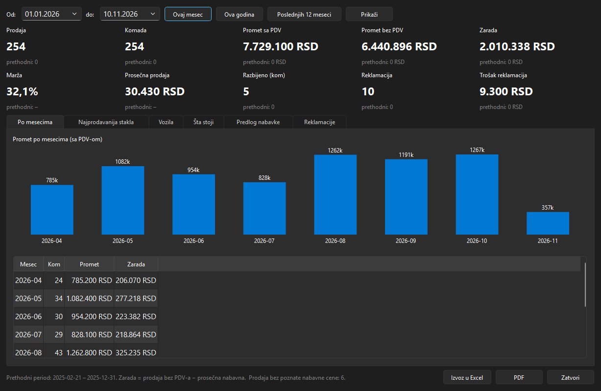
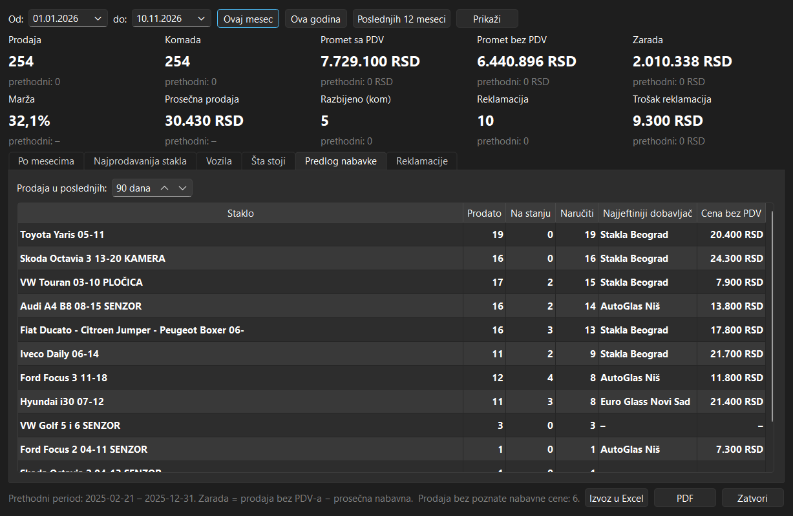
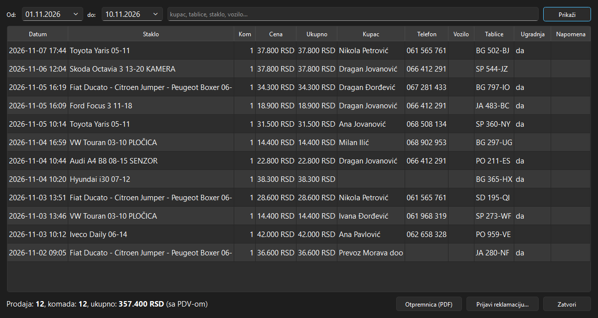

# AutoStaklaBetter – inventory, sales and analytics for a car glass workshop

A Windows desktop application for a small car glass workshop. It started as a replacement for an inventory list
kept on paper (where every windshield is stored, how many pieces are in stock, full history of every movement) and
grew into a small business system: sales and customers, suppliers and purchase prices, analytics, warranty claims
and documents.



## Features

**Inventory**
- Storage → shelf → position, exactly like the physical layout; inserting a piece renumbers the others
- Fast search (`golf 5 senzor`) and filters: storage, shelf, type, sensor, camera, used glass
- Stock is kept as movements (in, out, move, correction) with full history, never as an overwritten number

**Sales and purchasing**
- Every stock-out has a reason: sold, broken, returned to supplier, warranty replacement
- Sales with price, customer, vehicle, licence plates and installation; customer register
- Suppliers and a price list per glass and supplier with price history; the purchase price is suggested on stock-in
- Vehicle models are parsed from free-text glass names (`Fiat Ducato - Citroen Jumper - Peugeot Boxer 06-` →
  three vehicles, 2006–) with a review list for uncertain cases

**Analytics**
- Revenue, profit and margin compared with the previous period, monthly chart
- Best-selling glass and vehicle models, slow-moving stock, purchase suggestions with the cheapest supplier,
  warranty claims and their cost per supplier
- Export to Excel and PDF

**Warranty claims and documents**
- Claims linked to a sale with a status workflow (reported → at supplier → approved / rejected → resolved)
- Pro-forma invoice and delivery note as PDF (not fiscal receipts – fiscal receipts are issued only by certified
  software in Serbia)

**Operations**
- Installer (Inno Setup), in-app updates from a zip with a separate updater, automatic backups before every
  database change, audit and error logs, database check
- Two editions from one codebase: the basic inventory edition and the extended Better edition



## Technical notes

- **Python 3.13, PySide6 (Qt), SQLite**, PyInstaller, Inno Setup, openpyxl
- Numbered, **repeatable migrations** with a schema version (every migration is tested to run twice without
  errors or duplicates); new features add tables instead of rewriting existing ones
- **Money as integers** (whole dinars), never floating point; sale prices include VAT, purchase prices exclude
  it, profit = net sale − weighted average purchase price
- Charts drawn with QPainter (no charting library), light and dark theme
- **74 pytest tests**, including offscreen UI tests



All data in this repository (inventory, customers, sales) is invented demo data.

---

## Pokretanje

```
python -m venv .venv
.\.venv\Scripts\pip install -r requirements.txt
powershell -ExecutionPolicy Bypass -File tools\probaj_better.ps1     # demo baza sa ~7 meseci prodaje
.\.venv\Scripts\python.exe -m pytest -q
```

Izdanje (osnovno / Better) bira `EDITION` u `src\autostakla\version.py`. Arhitektura, migracije, update i backup:
[ARHITEKTURA.md](ARHITEKTURA.md); izmene po verzijama: [IZMENE.md](IZMENE.md).
